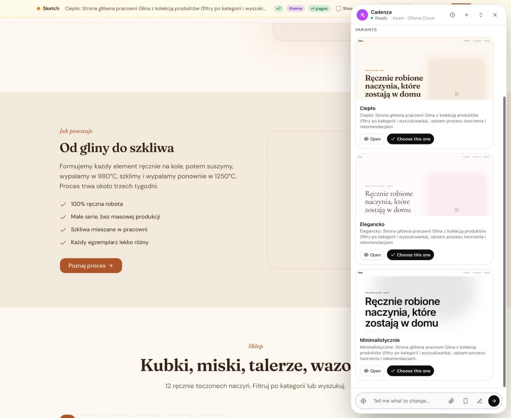
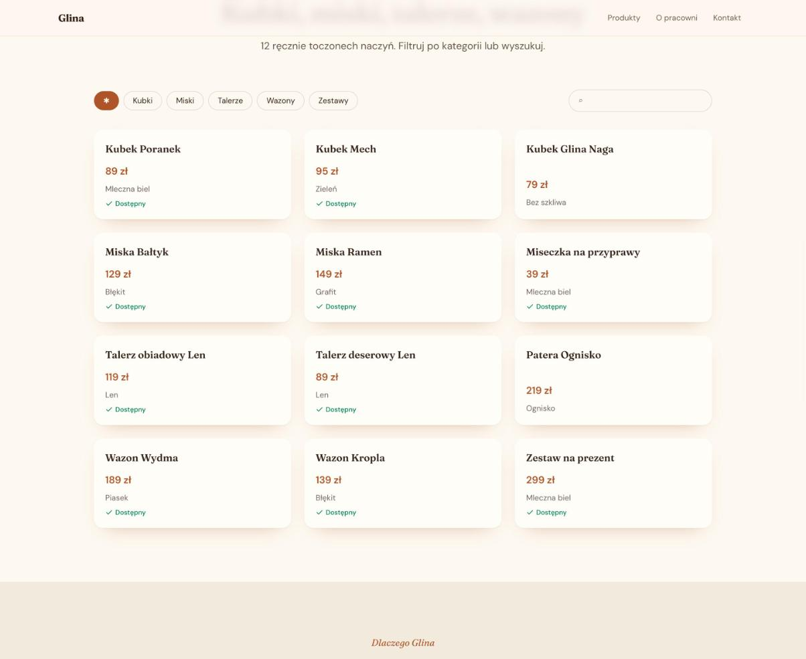

# Cadenza — your Symfony app improvises

**A living Symfony website that its non-technical owner shapes by talking to it.** Bring your material — a
spreadsheet, the photos on your phone, a drawn sketch, or just an idea — and Cadenza proposes a page. Every change
appears first as a **sketch on the live page**; nothing goes live until you approve it. Built for the
[Symfony AI & MCP Hackathon](https://symfony.com/hackathon) with Symfony AI 1.0.0-BETA1 and the official PHP MCP SDK.

> *Cadenza*: the passage of a concerto where the soloist improvises freely — on top of a solid structure.
> Here the owner improvises; Symfony is the structure.



## What it does

- **Chat on your own site.** A bar at the bottom, a side panel that slides out. Point at anything with the
  crosshair (“make *this* bigger”), attach photos, draw a layout with the pencil, or drop a spreadsheet.
- **Sketches, not surprises.** The agent proposes changes as a draft rendered on the real page; changes highlight on
  hover, *Before / After* toggles, and *Approve* publishes with a View Transition. Every published state is a version:
  preview, restore, undo, start over — history is never rewritten.
- **“How could my site look?”** Content written once, three design directions side by side as live thumbnails; keep
  one.
- **Beautiful by construction.** Pages are composed from designed **section patterns** (hero, feature split, menu,
  bento, steps, timeline, team, pricing, testimonials, logos, visit us, quiz, form, countdown, map, collection
  grid/table, call to action)
  and six **design directions** (minimal, editorial, warm, bold, elegant, fresh) built on UX Toolkit's shadcn kit.
- **Your data, not lorem ipsum.**
  - *Spreadsheet → shop/catalogue*: columns are analysed (price, category, image, date…), rows become records with
    their own pages, shown as cards with filter chips and search or as a sortable table.
  - *Photos from your phone*: a QR code, pick photos from the camera roll — no account, no app. EXIF dates and
    places group them into trip albums (“Zakopane, lipiec 2024”); live galleries update by themselves.
  - *Instagram*: the official export ZIP, or Instagram Login for Business/Creator accounts with a daily sync.
  - *Free photos*: the agent offers a grid of Wikimedia Commons photos (Pexels/Unsplash with a key) with author and
    licence; one click puts the chosen one into the sketch. Images are always stored by the site, never hot-linked.
- **A site that answers back.**
  - *Forms* for RSVPs, sign-ups with limited places (per form, or per date / class / time slot), orders, bookings,
    messages, surveys. Answers are validated against
    the form's own fields, stored, and announced as a `FormSubmitted` event (optional e-mail to the owner). The owner sees
    them on the page — only they do — downloads them as Excel, or simply asks: *“How many guests are coming, how many
    vegetarian meals, who has allergies?”*
  - *Countdown* to an event with an *Add to calendar* file, and an *announcement bar* that hides itself after a date.
  - *Maps*: “our trips” drawn from the GPS of the owner's phone photos as a route in time order, or pins for addresses
    (venues, shops) located automatically.
- **No ceiling: the agent writes new blocks.** When none of the patterns fits (*“a 4-week course plan with difficulty
  shown as dots”*), the agent defines a new block type — a prop schema and a Twig template — and uses it in the sketch.
  Its templates live in the database and run behind three walls: a separate Twig environment with no globals or
  services, the **Twig sandbox** (allow-listed tags, filters and functions), and Symfony's **HtmlSanitizer** on the
  output (no scripts, event handlers, styles, forms or foreign images). Tailwind picks up the new classes in the
  background.
- **Things that move: games, 3D, animation.** *“A Tetris for the guests”*, *“make the opening come alive with soft
  3D shapes”*, *“a breathing exercise: a circle that grows as you breathe in”*. The agent writes a **widget** — real
  HTML, CSS and JavaScript, with three.js, Chart.js, Matter.js or confetti from the site's own importmap — and the
  studio treats it like a programmer would: syntax checked, then **played in a headless Chrome with Symfony Panther**
  (start, a few keys, screenshots, the browser's errors); a model that can see looks at the screenshots and what is
  wrong goes back for a fix, before the owner sees the sketch. Widgets run as documents of their own with the sandbox
  in the response itself (an opaque origin: no cookies, no storage, no network but the site's libraries and photos);
  the page keeps a game's best score for each visitor, and a game can have a shared leaderboard. Every version of a
  widget is kept and a page pins the one it shows: *“make the snake slower”* becomes a sketch with the new version
  while visitors keep playing the approved one, and restoring an old version of the site brings its games back too.
- **Content that grows, by chat.** *“Add a post: the bus for guests leaves at 11:00”*, *“change the price of the vase
  to 140 zł”* — news, events, menus and products are collections the agent writes entry by entry. Every entry is a
  draft the owner sees marked on the page and publishes from a card in the panel; visitors keep the live version.
- **Other languages.** *“Lots of tourists come to Gdynia — make an English version.”* The page's texts are taken out
  of its tree, the model translates only that list, and the same page is rebuilt at `/en/…` with a language switcher,
  its own menu, and forms that speak English. Names of people, places and the business stay as they are.
- **Documents to download.** Attach a PDF (a menu, rules, a price list) and say where it belongs: it is stored by the
  site and shown with its type, size and number of pages.
- **Made for phones too** — visitors get a compact menu with the language switch, the owner gets the whole studio in a
  full-screen panel. *“How does my site look on a phone?”* — the owner sees the page (or its sketch) in a phone frame,
  and the agent opens it in a headless Chrome at phone size: it measures what sticks out, text too small to read and
  buttons too small for a thumb, and a model that can see looks at the screens.
- **The owner stays in charge.** Nothing goes live without approval — new pages, a moved section, a new version of a
  game, an undo (*“bring back how it was”* is a sketch of an earlier version too). Sketches from earlier conversations
  wait in a card of their own; *“what is waiting for me?”* gets a short answer and *“drop the weather one”* drops
  just that. The agent asks before removing pages, never writes reviews or prices it was not given, and says plainly
  what it could not do.
- **Pages for invited people only.** *“Make the accommodation page visible only to our guests”* — the page gets a lock;
  the owner adds guests (or tells the agent *“invite Kasia and Piotr…”*) and copies each one's personal sign-in link
  (Symfony login links: signed, expiring, no passwords). Strangers see a closed door that does not reveal what is
  behind it; a guest who lost the link asks for a new one by e-mail.
- **A dashboard for the owner** (grid icon in the panel): visits counted without cookies or personal data, answers to
  forms with places taken, recent changes, content, and the application's health — errors in the logs, whether the
  background worker is alive, jobs waiting or failed, imports, connected accounts. The agent reads the same numbers:
  *“How is the site doing?”*
- **Self-aware.** The agent reads the app's logs and profiler through **Symfony AI Mate**; one broken block never takes
  a page down; a busy model hands over to a fallback model.



## Quick start (5 minutes)

Requirements: PHP 8.4+ (`pdo_sqlite`, `gd`, `intl`, `zip`, `sodium`), Composer. The Symfony CLI is used when present.

```bash
git clone <this repository> cadenza && cd cadenza
./cadenza setup        # dependencies, SQLite databases, assets, a shared secret — nothing to configure by hand
```

```bash
./cadenza start        # → open http://127.0.0.1:8010
```

No file to edit for the model: with none connected yet, the panel opens **Connections**. It lists what this computer
already has, so connecting takes one click (Ollama or LM Studio running here, a key already in your environment); for
the rest you paste a key, which is checked with one request and kept encrypted. Ollama Cloud and OpenRouter have free
plans that Cadenza was tested with.

The first visit asks you to create the **owner account** (e-mail and password; possible only from the computer that runs
the site, or with the setup token). Then the Cadenza bar is at the bottom; later you sign in at `/_cadenza/login`, and a
forgotten password is reset with `bin/console cadenza:owner` in `demo-app/`.

Try: *“Jak mogłaby wyglądać strona mojego studia jogi?”*, attach [`examples/glina-cennik.xlsx`](examples/glina-cennik.xlsx)
and ask for a shop, or click the phone icon and send photos from your phone (same Wi-Fi, or deploy it).

### Things people have built with it

| The owner says | Cadenza builds |
|---|---|
| “We're getting married on 14 June in Kazimierz — a page for the guests with an RSVP: name, how many, menu, a bed for the night, allergies. Answers by 1 May.” | timeline of the day, travel and stay, an RSVP form counting places and closing on 1 May, later a countdown with *Add to calendar*, a reminder bar, a map of the church and the party venue |
| “How many vegetarian meals do we need?” | reads the answers and replies with the numbers |
| *(attaches a price list)* “Make a shop out of this.” | a collection with a page per product, cards with filter chips and search, three looks to choose from |
| *(sends photos from the phone)* “Our trips on a map.” | albums per trip, a map with the route and the photos |
| “A yoga studio in Gdynia… sign-ups for three November workshops, 10 places each.” | three looks to choose from; a form where each date shows its places left and closes when full |
| “Lots of tourists come here — make an English version.” | `/en` with the same layout, an English menu and a PL/EN switcher |
| “Add a news page for the guests: the bus from Warsaw leaves at 11:00…” | a news list sorted by date, posts as drafts to publish from the panel |
| “A page that explains photosynthesis, with a quiz at the end.” | sections, steps, a quiz with explanations and a score |

`./cadenza test` runs all test suites; `./cadenza reset` starts the site over; `./cadenza stop`.

## Architecture

```
┌──────────────────────────────── harness/ — Cadenza Studio ────────────────────────────────┐
│  Symfony AI Agent (tools) ─ proposals (Symfony Workflow state machine) ─ conversations      │
│  image search & generation ─ uploads ─ tool policy (sketch first, budgets) ─ fallback model │
│  MCP client of the site ──────────────┐            SSE stream to the panel (trace, UI, cards) │
└───────────────────────────────────────┼─────────────────────────────────────────────────────┘
                                        │ MCP over HTTP: server "agent" (read + drafts), "control" (publish)
┌───────────────────────────────────────▼──── demo-app/ — the owner's website ────────────────┐
│  runtime-bundle/: page tree + operation language, drafts & versions, renderer (Twig          │
│  Components, UX Toolkit), studio panel, MCP servers, media library, collections, connectors  │
│  Messenger (imports, events) · Scheduler (daily sync) · Symfony AI Mate (logs, profiler)     │
└─────────────────────────────────────────────────────────────────────────────────────────────┘
library/sources/instagram — first block package (Composer, cadenza.json manifest), installed into the app
```

- **The agent never edits templates.** A page is a declarative tree of typed nodes with stable ids; the agent sends
  small operations (`node.insert`, `node.replace`, `theme.update` …) that are validated against the node catalogue.
  Replacing an element is one operation on one id.
- **Two processes on purpose.** The studio is never modified by the agent, and the site's MCP servers separate what an
  agent may do (`agent`: read, propose drafts) from what only the owner's approval does (`control`: publish).
- **Safety is code, not prompt.** Only the approve transition publishes; image props accept only the site's media
  library; a tool policy enforces “sketch first” and budgets; credentials of connected accounts are sealed with
  libsodium and never reach the model.
- **Events everywhere.** Imports emit `MediaImported`, jobs run in Messenger, connections sync on a schedule — blocks
  plug into events instead of calling each other.

More: [PROJECT_SPEC.md](PROJECT_SPEC.md) (vision and design, in Polish), [docs/DEMO.md](docs/DEMO.md) (90-second demo
script), [docs/UPSTREAM_ISSUES.md](docs/UPSTREAM_ISSUES.md) (what we found in the betas).

## What Symfony AI and MCP unlocked

| Piece | Used for |
|---|---|
| **Symfony AI Agent** + Toolbox events | the studio agent; `ToolCallRequested` enforces the tool policy and streams a live trace to the panel |
| **Platform** (generic bridge, structured messages, images) | any OpenAI-compatible provider; vision for sketches and photos |
| **MCP Bundle — servers** | the site exposes `agent` and `control` servers, the editing guide as an MCP **prompt**, the outline as a **resource** |
| **MCP Bundle — client** | the studio drives the site only through MCP |
| **Symfony AI Mate** | the agent reads the app's logs and profiler, even when the app does not boot |
| **Messenger, Scheduler, Workflow** | imports and events (`MediaImported`, `FormSubmitted`); daily sync of connected accounts; the proposal state machine |
| **Security, Translation** | the owner's sign-in (form login, login throttling, remember-me, stateless CSRF), first-run setup; members' passwordless login links; texts in the site's language |
| **Twig Sandbox, HtmlSanitizer** | blocks the agent writes itself: allow-listed Twig in an isolated environment, sanitised output |
| **Panther, Process** | the agent tries the games and animations it wrote in a headless Chrome before the owner sees them |
| **RateLimiter, Mailer** | visitors' forms: a sliding window per address against bots, an optional note to the owner |
| **UX Toolkit (shadcn), Twig/Live Components, Turbo, Icons** | patterns, the panel, View Transitions between versions |
| **Doctrine, Uid, HttpClient, PhpSpreadsheet** | drafts and versions, media, collections; spreadsheets in (collections) and out (form answers) |
| **AssetMapper (importmap)** | Leaflet for maps, loaded only on pages that have one; three.js, Chart.js, Matter.js for widgets, served to their sandbox by the site — no Node, no build step for JS |

## Models

The studio talks to any OpenAI-compatible chat API with tool calling. The owner connects one in the panel
(**Connections**, the plug icon): Cadenza finds model servers running on this computer (Ollama, LM Studio, the port LM
Studio says), keys in the environment it was started with (`OLLAMA_API_KEY`, `OPENROUTER_API_KEY`, `HF_TOKEN`,
`OPENAI_API_KEY`…; used by reference, not copied) and the coding CLIs signed in with the owner's own plan. A pasted key
is tried with one request, then kept in the studio's **vault**: `harness/var/vault/`, a JSON file encrypted with
libsodium's secretbox under a key of its own, both readable by the owner of the files only and never committed. Key
values go in through the panel and never come back out — the agent only learns *connected* or *not*.

The vault plugs into Symfony's configuration as an env var processor: settings read as `%env(vault:CADENZA_LLM_MODEL)%`
come from the environment the studio was started with first (a start script that exports keys, like
`harness/bin/serve-with-1password`, still wins), then from the vault, then from the `.env` files. So the settings below
can still be written by hand in `harness/.env.local`:

| | `CADENZA_LLM_BASE_URL` | `CADENZA_LLM_MODEL` |
|---|---|---|
| Hugging Face *(not yet tested by us)* | `https://router.huggingface.co` | `Qwen/Qwen3-Coder-480B-A35B-Instruct` |
| Ollama Cloud *(tested)* | `https://ollama.com` | `beam?max_tokens=12000&reasoning_effort=low` |
| OpenRouter *(tested, free models)* | `https://openrouter.ai/api` | `nvidia/nemotron-3-ultra-550b-a55b:free?max_tokens=12000` |
| LM Studio / Ollama, local *(LM Studio tested)* | `http://127.0.0.1:1234` | the loaded model |

Also `CADENZA_LLM_API_KEY`, and optionally a fallback (`CADENZA_LLM_FALLBACK_*`, used when the main model is silent for
75 s) and a vision model (`CADENZA_LLM_VISION_*`, used for messages with images). Model options travel in the model
name's query string. Widgets: `CADENZA_CODE_MODEL` (the model that writes their code; default the main one) and
`CADENZA_REVIEW_MODEL` (a model of the main API that looks at the screenshots of a widget under test, e.g.
`gemma4:31b` on Ollama Cloud's free plan; default the vision model). Optional: `HUGGINGFACE_API_KEY` (image generation with FLUX), `PEXELS_API_KEY`,
`UNSPLASH_ACCESS_KEY`, `INSTAGRAM_CLIENT_ID`/`INSTAGRAM_CLIENT_SECRET`. In a side-by-side run on Ollama Cloud's free models (a
Breakout with power-ups and a memory game, each written, played in Chrome and reviewed), `beam` wrote both working
(about 1–3 minutes each); `gpt-oss:120b` was faster but one game crashed on load, and `nemotron-3-ultra` took six
minutes and left the memory board empty — so the code model defaults to the main one. Replies in Polish are proofread by
`CADENZA_PROOFREAD_MODEL` (default: the review model; `bin/serve-with-1password` uses `gpt-oss:120b`, which fixed
spelling and forms best of the free models we tried), a pass that fixes words and forms and changes nothing else.
Pictures the owner attaches (photos, a layout drawn by hand) are looked at by `CADENZA_SEEING_MODEL` (the start script
uses `gemma4:31b` on Ollama Cloud): it describes them, and the main model builds the page from that description — a
model that sees well is not always good with tools, and the free vision models elsewhere are rate-limited.

**Your own plan for games and widgets.** Signed in to Claude Code (Claude plan) or Codex (ChatGPT plan) on this
computer? Connections offers *Write games with it*: the code of widgets is then written through that CLI with Symfony
AI's `symfony/ai-claude-code-platform` and `symfony/ai-codex-platform` bridges (`CADENZA_CODE_MODEL=claude-code:sonnet`
or `codex:<model>`), while the chat stays on the API above — the bridges return text, not tool calls. The CLI runs with
every tool of its own switched off (Claude Code: `--tools ""`, `--strict-mcp-config`; Codex: a read-only sandbox) in an
empty directory. It is meant for the owner's own computer, with the owner's own plan; check your plan's terms before
running it for anyone else.

Smaller and free models make mistakes in tool arguments (numbers as strings, JSON as strings, extra brackets). The
studio tolerates them on purpose (`LenientArgumentResolver`, `JsonRepair`) and enforces the important rules in code.

## Repository

```
cadenza                  setup / start / stop / test / reset
runtime-bundle/          Cadenza runtime (Symfony bundle) — tests: vendor/bin/phpunit
harness/                 Cadenza Studio (Symfony app) — tests: bin/phpunit
demo-app/                a fresh Symfony 8.1 app with the runtime installed — tests: bin/phpunit
library/sources/         block packages (Instagram)
examples/                sample files to try
```

## Known limitations

- A full page from a free cloud model takes 1–4 minutes; local or paid models are much faster.
- Blocks the agent writes are templates, not PHP: they cannot run code or scripts (by design); code that runs is
  a widget, sandboxed in a frame of its own. Free models write simple games well and ambitious ones (Frogger) with
  rough edges: the browser test catches crashes and blank screens, not every rule of a game. Trying widgets needs
  Chrome on the studio's computer (`./cadenza setup` fetches its driver); without it they are only syntax-checked.
- One owner account per site (Symfony Security: form login with CSRF, throttling, remember-me); run behind HTTPS
  before exposing it. The studio talks to the site with a shared token kept in `.env.local`.
- Instagram Login needs a Meta app and a Business/Creator account; the export ZIP works for everyone.
- Maps use OpenStreetMap tiles and Nominatim (fine for a small site; a busy one should use its own tile/geocoding
  provider). Form answers can contain visitors' personal data: the agent reads them only when the owner asks.

## License

MIT — see [LICENSE](LICENSE).
